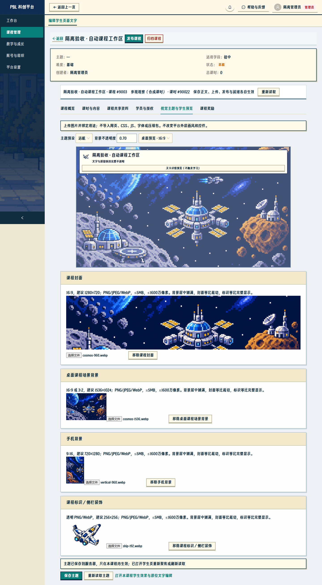

# 管理员操作指南 · 第 1 步

## 从哪里开始

管理员登录后侧栏为工作台、课程管理、教学与成长、账号与组织、平台设置。通知、个人账号、改密和退出保留在顶部。工作台待办最多显示每类前 10 项，点击直接进入对应报告、订单、反馈或课时；完整列表从对应模块进入。旧链接仍打开原对象。

“教学与成长”进入报告/作品评审列表后直接打开所选对象，不需要重新选择课程结构。账号导入、凭据交付、人员分配、停用和迁移历史在账号与组织的原账号页面；学校/班级在同模块的“学校与班级”。

## 新建课程与填写清单

1. 课程管理 → 新建课程。填写名称、学段、难度；创建账号作为现有负责人。
2. 保存后进入该课程工作区，状态为草稿；不会自动发布。
3. 课程概览列出真实字段和缺项。建议发布前补齐简介、核心问题、学习目标；这些检查不新增后端发布门槛。故事和材料按需要填写。
4. 六个页签为课程概览、课时与内容、课程共享资料、学员与授权、视觉主题与学生预览、课程奖励。顶部显示课程名称与真实 ID，课时工作区同时显示课时名称与 ID。
5. 发布课程、撤回和归档仍执行原规则：有学习历史不能撤回草稿；尚有最新待评/待修改报告或作品时不能归档。归档保留历史、只读管理。

## 新建与维护课时

1. 课时与内容 → 新建课时，选择普通教学、参观体验、理论学习或实践操作。模板说明只作管理员填写提示，不会写进学生教材。
2. 填写真实课时名称。安排信息可以稍后补；时长沿用原规则，为正整数分钟，留空不显示。图片可不填，使用默认岩石。
3. 保存后课时为准备中；系统按服务端真实 lessonId 自动加入新课程地图。课程内的实验需要显式关联，不自动绑定滑翔机。
4. 下拉框可搜索课时。原位编辑文章、回顾、报告引导；“知识卡片与练习”打开同一套原编辑器。“新增独立任务”保留原任务对象和提交规则。编辑框保存、关闭后回到当前课程/课时；切换前会保护未保存或正在处理的输入。
5. 关卡图与安排在“课时标题与安排”编辑。上传 PNG/JPEG/WebP 后还须保存课时；站位横纵范围为 0.1–0.9。失败不会替换原图。未上传或文件错误时使用岩石。
6. 文章可添加段落、选择当前课时图片、调整顺序。上传后须保存正文才会成为文章引用。移除文章引用不删除原文件。
7. “上传本课时资料”与文章/回放内上传自动绑定当前课时；共享资料必须从课程共享资料页上传。引导卡文件与知识卡片是不同对象，上传文件不会生成习题。
8. 课时卡片分别保存草稿或显式发布；不要把“保存正文”理解为发布卡片。“本课时内容与开放状态”列出草稿/已发布数、文件、版本和真实缺项。逐课时检查后才标记已准备；原学习前置条件仍生效。
9. “查看教材版本与适用范围”显示已绑定版本。新进入学生使用当前教材；已绑定学生保留原快照、作答、报告与评分依据。需要历史兼容修复时使用原卡片编辑器中的定向修复，不在本步批量替换历史教材。
10. 旧课时的取消、独立任务取消、回放编辑/删除在“高级课时安排、独立任务与取消”；原独立内容编辑深链接仍可使用同一编辑器。

新课程使用自动地图，排序在课时基本信息中修改，取消课时会同步移除其有效路线节点而保留历史。沿用现有地图表最多 100 个有效节点的限制；超过会拒绝并回滚创建。存量十关地图仍在原“章节、地图顺序及历史绑定”中维护，不自动重排、删关或转成新地图。

## 上传课程主题

先按项目像素风 skill 准备图片，复用现有素材亦可；本步没有生成新美术。管理员无需修改代码、CSS 或 JSON。

|用途|建议素材|显示方式|
|---|---|---|
|课程封面|1280×720，16:9|课程选择卡片等比裁切|
|桌面课程场景背景|1536×1024，16:9 或 3:2|当前课程地图与课时场景居中铺满|
|手机背景|720×1280，9:16|窄屏纵向铺满；未填使用桌面图居中裁切，文件失效回预设|
|课程标识/侧栏装饰|256×256，透明 PNG/WebP|当前课程导航等比完整显示|
|具体关卡图片|建议透明 PNG/WebP，约384×384|在对应课时上传，独立设置角色站位|

1. 视觉主题与学生预览 → 选择校园/远航预设。
2. 在对应用途选择图片；每张只接受 PNG/JPEG/WebP、≤5MB、≤1600万像素，服务器会验证真实文件结构和课程归属。
3. 上传成功仅表示图片已存服务器。桌面、平板、手机适配预览可切换；背景不透明度只作用在背景图片，正文/按钮不透明度不变。
4. 点击“保存主题”，主题只影响当前课程。替换失败保留旧图，可点“重试上传”使用原文件与请求编号重试；上传重试成功仍须保存主题才改变绑定。移除后保存使用预设。历史文件仍保留，不批量删除。
5. 从“打开本课程学生效果与原位文字编辑”进入真实同源预览。正文和真实教学字段仍走原对象编辑器；系统文字的一步保存同步与教材发布分开。
6. 学生重新聚焦或刷新读取当前课程主题。登录、探索首页外层及“我的”保留原北航风格和平台字体/控件。

## 保存失败与边界

网络失败保留当前输入；收到保存成功后回读失败，只重新读取已保存对象，不再次新建。课程/课时创建重试保留同一请求编号；结果不明时不要另开窗口重新建同一课时。主题或教学修订冲突时核对最新服务器版本，再决定是否保存自己的输入。

选填教学文字为空、富文本空段、无有效附件时，学生端不显示空区块；清空后不会回退旧提示。有效 0 值仍显示。必要学习动作、未开放原因、权限与网络错误继续保留。

学员与授权暂时仍执行原报名导入/移除权限；课程管理授权与学校申请是第 2 步。课程奖励目前保留原课时徽章设置和“存量奖励，待关联课程”入口，真实礼品、订单发放、通知补发仍可用；礼品课程归属和可选勋章开关属于第 3 步。本步不重算金币、不发历史奖励、不启用 AI。
